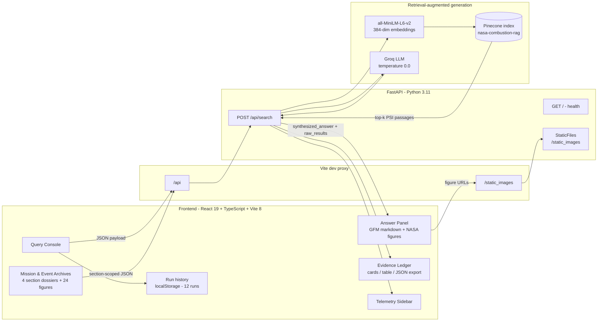
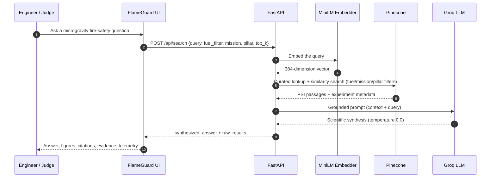
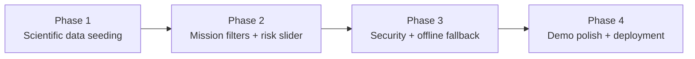

<div align="center">

# FlameGuard — NASA Space Apps Microgravity Fire Safety Super-Intelligence

**A retrieval-augmented generation (RAG) console for NASA microgravity combustion science — with mission & event archives.**
Ask a natural-language fire-safety question, get a grounded scientific synthesis, and verify every claim against the exact NASA PSI passages and extracted figures behind it. Explore four section-scoped dossiers on **ISS combustion science**, **Apollo 1**, **Apollo 13** and **Mir**, each with archival NASA imagery and a query box that retrieves only from that mission's corpus section.

[](https://www.spaceappschallenge.org/)
[](#why-flameguard)
[](#how-the-rag-pipeline-works)
[](backend/)
[](frontend/)
[](https://www.pinecone.io/)
[](https://groq.com/)

[Features](#features) · [Mission archives](#mission--event-archives) · [Architecture](#architecture) · [Quick start](#quick-start) · [API reference](#api-reference) · [Roadmap](#roadmap-and-production-readiness) · [FAQ](#frequently-asked-questions-faq)

</div>

---

## Overview

**FlameGuard** is a hackathon-ready **AI decision-support dashboard for spacecraft fire safety**, built for the **NASA Space Apps Challenge** and the **Physical Science Informatics (PSI)** microgravity combustion corpus. It combines a **FastAPI** retrieval service, **Pinecone vector search**, locally generated **HuggingFace MiniLM sentence embeddings**, and a **Groq-hosted large language model** with a mission-control **React + TypeScript** interface.

Two workspaces share one retrieval API:

- **Query console** — global search across the corpus with fuel, mission and safety-pillar filters.
- **Mission & Event Archives** — four dossiers (**ISS Combustion Science**, **Apollo 1**, **Apollo 13**, **Mir**) with section-scoped retrieval, archival NASA figures and per-section answer caching.

The project answers questions such as:

- How does **flame spread** behave over solid **PMMA acrylics** in **microgravity**?
- What **ignition limits** were observed for **liquid fuel pool fires** at **30% oxygen**?
- How does **low-velocity airflow** affect flame spread over **solid fabrics**?
- What **smoke transport** behaviour was reported in the **Saffire** experiments?

Every answer ships with the **raw PSI evidence**, **experiment metadata**, **fuel-state tags**, **source citations**, **extracted NASA figures**, and **retrieval telemetry**, so engineers can audit the science instead of trusting a black box.

> Keywords: NASA Space Apps, microgravity fire safety, spacecraft fire safety, combustion science, Physical Science Informatics (PSI), BASS-II, Saffire, FLEX, FLEX-2, ACME, SoFIE, SAME, PMMA, flame spread rate, opposed-flow combustion, cool flames, oxygen enrichment, lunar habitat, Artemis, spacesuit EVA, International Space Station, Apollo 1, Apollo 13, Mir space station, Kvant-1, Vika SFOG, NASA-STD-6001, section-scoped retrieval, metadata filtering, mission archives, archival imagery, retrieval-augmented generation, RAG, vector database, Pinecone, semantic search, LangChain, FastAPI, React, TypeScript, Vite, Tailwind CSS, Groq, Llama 3, GPT-OSS, dashboard, open science.

---

## Why FlameGuard

Fire behaves differently in space. Without buoyancy, flames spread through **forced airflow**, **oxygen concentration**, and **pressure** rather than the convection currents we rely on on Earth. A habitat leak, an oxygen-enriched atmosphere, or a **spacesuit EVA** environment can turn a small ignition source into a mission-critical event.

FlameGuard targets three fire-safety pillars defined by NASA research:

| Pillar | Scientific question | Relevant NASA science |
| --- | --- | --- |
| **Prevention** | What ignites, and how fast does it spread? | Flammability limits, opposed-flow flame spread, PMMA and fabric tests (BASS-II, Saffire) |
| **Detection** | How do smoke and particulates move in microgravity? | Smoke transport, particulate sensors (SAME, Saffire) |
| **Suppression** | How do we extinguish a fire in low gravity? | CO2 / helium / water-mist dilution (FLEX, FLEX-2) |

Reference environments referenced by the challenge:

| Environment | Oxygen | Pressure | Why it matters |
| --- | ---: | ---: | --- |
| Lunar habitat | 30–34% | 10.2 psi | Elevated O2 raises flammability risk |
| Spacesuit EVA | 100% | 4.3 psi | Pure oxygen, low pressure |
| ISS / space station | 21% | 14.7 psi | Baseline microgravity environment |
| Mars habitat | 28% | 8.2 psi | Low-pressure, oxygen-enriched habitat |

---

## Features

| Capability | What it does |
| --- | --- |
| **Natural-language query console** | Ask research questions in plain English with a `Ctrl/Cmd + Enter` shortcut, 500-character counter, and preset benchmark prompts. |
| **Grounded scientific synthesis** | A temperature `0.0` LLM answer constrained to retrieved PSI context; the prompt explicitly extracts oxygen %, pressure, and flame-spread speed. |
| **Mission & Event Archives** | Four fixed dossiers — ISS Combustion Science, Apollo 1, Apollo 13 and Mir — with briefings, key telemetry, starter prompts and a dedicated query box. |
| **Section-scoped RAG** | Archive queries send the exact `section` literal and explicitly `null` the global environment, mission, pillar and fuel filters, so retrieval cannot blend events. |
| **Archival image galleries** | **24 verified NASA images** (six per dossier) with figure labels, captions, archival credits, lazy loading and a zoomable lightbox. |
| **Per-section answer cache** | Each dossier keeps its own query, top-k, answer and evidence trail, so switching sections never loses work. |
| **Safety transparency** | Optional `active_source` pill (**PINECONE** vs **FALLBACK**) and an `is_safe === false` guardrail alert when the API supplies them. |
| **Evidence Ledger** | Every passage returned by retrieval, with **card view** (term highlighting), **table view**, client-side fuel filtering, and one-click **JSON export**. |
| **GFM Markdown rendering** | GitHub-flavored Markdown via `react-markdown` + `remark-gfm`: tables, code blocks, blockquotes, links, and figures. |
| **NASA figure pipeline** | Extracted PDF figures are served at `/static_images/*` and rendered with rounded borders, dark shadows, aspect-ratio preservation, and a graceful fallback for missing assets. |
| **Retrieval telemetry** | Live passage count, unique experiments, fuel-state split, experiment mix, and end-to-end latency. |
| **Run history** | The last **12** searches are stored in `localStorage` with restore and delete controls; archive runs carry a `[section]` tag. |
| **Backend health polling** | Real-time `API ONLINE` / `API OFFLINE` status pill driven by a lightweight health check. |
| **Responsive mission-control UI** | Dark space theme built with Tailwind CSS 4, audited from 394 px mobile widths up to desktop and ultrawide layouts. |
| **Zero-CORS development** | Vite proxies `/api`, `/healthz`, and `/static_images` to FastAPI, so no CORS configuration is needed locally. |

---

## Mission & Event Archives

The **Mission archives** workspace turns four NASA fire-safety milestones into self-contained dossiers. Each dossier combines a curated briefing, key parameters, archival figures and a **section-scoped query box** that posts to `/api/search` with `section` set to the exact API literal.

| Display title | API `section` literal | Era | Core hardware / system | Retrieval focus |
| --- | --- | --- | --- | --- |
| **ISS Combustion Science** | `Combustion Science` | 2000s → present | CIR, MSG, Cygnus / Saffire | Cool flames, soot, LOI, wall confinement |
| **Apollo 1** | `Apollo 1` | 27 Jan 1967 | AS-204 · Block I CM-012 · Pad 34-A | 16.7 psia pure O₂, hatch, NASA-STD-6001 |
| **Apollo 13** | `Apollo 13` | April 1970 | SM Bay 4 · Cryogenic O₂ Tank No. 2 | 65 V thermostat failure, PTFE ignition |
| **Mir Space Station** | `Mir` | 23–24 Feb 1997 | Kvant-1 · Vika (TGK) SFOG | Lithium perchlorate jet flame, egress |

### Section-scoped request contract

```json
{
  "query": "Why do cool flames occur in FLEX?",
  "section": "Combustion Science",
  "top_k": 4,
  "environment": null,
  "fuel_filter": null,
  "mission": null,
  "pillar": null
}
```

- The four section strings are **exact-match** Pinecone metadata values; display titles are kept separate in `frontend/src/data/missionSections.ts`.
- Global filters are sent as `null` so a previously selected ISS/Lunar Base filter cannot intersect with an Apollo or Mir query and return zero chunks.
- Queries are normalised with `trim().replace(/\s+/g, ' ')` before the length check, matching the backend `_sanitize_query` rule. Submit stays disabled below **5 non-space characters** and above **500**, preventing HTTP 422 responses.
- Switching dossiers preserves each section's query, `top_k`, answer and evidence trail; completed runs are also written to the shared **RECENT RUNS** history with a `[section]` tag.
- `active_source` and `is_safe` are rendered when the API includes them; the current backend contract is unchanged, so the UI degrades gracefully when they are absent.

### Archival imagery (24 verified NASA images)

All assets are bundled locally under `frontend/public/sections/` so demos never depend on a live external image API. Every figure stores `src`, `figureLabel`, `caption`, `sourceDoc` and `credit`, and opens in an accessible lightbox (`Esc` / backdrop close, scroll lock).

| Dossier | Figures |
| --- | --- |
| **ISS Combustion Science** | BASS-II flame regimes · blue-flame droplets · quiescent near-limit flames · CIR in-flight maintenance · ACME chamber insert · Saffire-IV plexiglass burn |
| **Apollo 1** | AS-204 prime crew · prime & backup crews · 2015 Day of Remembrance · CM-012 interior after the fire · Spacecraft 012 hoisted at Pad 34 · crew at Launch Complex 34 |
| **Apollo 13** | Prime crew · damaged Service Module Bay 4 · Mission Control · fused thermal switch · full-scale tank fire propagation test · Apollo 14 oxygen tank cutaway |
| **Mir Space Station** | Mir from STS-63 (two views) · Jerry Linenger in a Sokol suit · Linenger EVA · Mir interior node · Mir photographed from STS-81 |

> Credits follow the **NASA Media Usage Guidelines**. FlameGuard is an independent hackathon project and does not imply NASA endorsement.

---

## Architecture

### System diagram



<details>
<summary>Plain-text architecture fallback</summary>

```text
Browser (React 19 + TypeScript)
        |
        |  POST /api/search  { query, section?, fuel_filter, mission, pillar, top_k }
        v
Vite dev proxy  --------------->  FastAPI (Python 3.11)
                                     |
                                     |  embed query
                                     v
                              all-MiniLM-L6-v2 (384-dim)
                                     |
                                     |  cosine similarity search
                                     v
                              Pinecone: nasa-combustion-rag
                                     |
                                     |  top-k passages + metadata
                                     v
                              Groq LLM (temperature 0.0)
                                     |
                                     |  synthesized_answer + raw_results
                                     v
Browser  <---- Markdown, tables, figures, telemetry, citations
```

</details>

### Request lifecycle



---

## How the RAG pipeline works

1. **Ingestion** (`backend/app/scripts/setup_vector_db.py`): NASA PDFs are read with **PyMuPDF**, split with `RecursiveCharacterTextSplitter` (`chunk_size=1000`, `chunk_overlap=150`), embedded with **`all-MiniLM-L6-v2`** (384 dimensions), and upserted into the **Pinecone** index `nasa-combustion-rag` (cosine metric, serverless AWS `us-east-1`). `seed_curated_psi.py --apply` adds the validated curated records with `pillar`, `environments` and `citation` metadata.
2. **Curated-first retrieval** (`backend/app/curated.py`): 17 validated NASA PSI records are scored by keyword/label/text overlap and filtered by fuel state, mission environment and safety pillar. They are merged ahead of Pinecone passages; Pinecone fills the remaining slots and curated records keep working if the index is unavailable.
3. **Grounded synthesis**: passages are formatted as `Experiment: ... / Pillar: ... / Environment: ... / Data: ...` context and injected into a system prompt that casts the model as a **NASA Super Intelligence aerospace engineer specializing in microgravity fire safety**.
4. **Evidence-first response**: the API returns both `synthesized_answer` and the untouched `raw_results`, so the frontend can render citations, telemetry, and the complete evidence trail.
5. **Figure resolution**: `data/images/...` references are rewritten to `/static_images/...`; the backend serves them via **FastAPI `StaticFiles`**, and the frontend normalizes relative or malformed image URLs before rendering.

> The model is instructed to answer **"the data is not available in the current PSI parameters"** when retrieved context is insufficient. This refusal behaviour is intentional: scientific honesty over hallucination.

---

## Tech stack

| Layer | Technology | Version | Role |
| --- | --- | --- | --- |
| Frontend framework | **React** | 19.3 | Component UI |
| Language | **TypeScript** | ~7.0 | Type-safe client |
| Build tool | **Vite** | 8.3 | Dev server, proxy, production build |
| Styling | **Tailwind CSS** | 4.3 | Mission-control dark theme |
| Icons | **lucide-react** | 1.66 | Interface iconography |
| Markdown | **react-markdown + remark-gfm** | 10.1 / 4.0 | GFM tables, code, figures |
| Linting | **oxlint** | 1.89 | Fast static analysis |
| API | **FastAPI + Uvicorn** | 0.162 / 0.54 | Async HTTP service |
| Language | **Python** | 3.11 | Backend runtime |
| Orchestration | **LangChain** | 1.4 | Prompt + retrieval chain |
| Embeddings | **HuggingFace `all-MiniLM-L6-v2`** | via `langchain-huggingface` | Local 384-dim vectors |
| Vector database | **Pinecone** | 7.3 | Semantic retrieval |
| LLM | **Groq `openai/gpt-oss-20b`** | via `langchain-groq` | Temperature-0 synthesis |
| PDF extraction | **PyMuPDF** | 2.0 | Text and figure extraction |
| Rate limiting | **slowapi** | 0.1 | 5 requests/minute per IP |
| Testing | **pytest / Vitest + Testing Library** | 8.x / 5.x | Backend and frontend suites |

---

## Repository layout

```text
NASA-Hackathon-flameguard/
├── backend/
│   ├── app/
│   │   ├── main.py                 # FastAPI app, curated-first RAG chain, static figure mount
│   │   ├── curated.py              # Curated PSI loader, normalisation and hit scoring
│   │   └── scripts/
│   │       ├── nasa_ingestion.py   # NASA OSDR metadata / dataset downloader
│   │       ├── seed_curated_psi.py # Push validated PSI records into Pinecone
│   │       └── setup_vector_db.py  # PDF -> chunks -> embeddings -> Pinecone
│   ├── data/
│   │   ├── curated/                # Validated NASA PSI JSON records
│   │   ├── images/                 # Extracted figures served at /static_images
│   │   └── raw/                    # Source NASA PDFs (Saffire, Mir, ...)
│   ├── tests/                      # pytest suite (offline provider stubs)
│   ├── pytest.ini
│   ├── requirements.txt
│   ├── requirements-test.txt
│   └── .env                        # PINECONE_API_KEY / GROQ_API_KEY (never commit)
├── frontend/
│   ├── public/
│   │   └── sections/               # 24 bundled archival figures (iss-combustion, apollo-1, apollo-13, mir)
│   ├── src/
│   │   ├── components/             # QueryConsole, MissionArchives, ImageLightbox, AnswerPanel, EvidenceLedger, ...
│   │   ├── data/
│   │   │   └── missionSections.ts  # 4-section registry: briefings, metrics, images, starter prompts
│   │   ├── types/
│   │   │   └── search.ts           # section-scoped request contract
│   │   ├── hooks/                  # useBackendStatus, useSearchHistory
│   │   ├── lib/                    # api client (runSearch / runSectionSearch), markdown helpers, formatting
│   │   ├── App.tsx                 # console/archive routing + shared run history
│   │   └── index.css
│   ├── tests/                      # Vitest + Testing Library suite (62 tests)
│   ├── vitest.config.ts
│   ├── vite.config.ts              # /api, /healthz, /static_images proxy
│   └── package.json
├── docs/
│   └── NASA-new mix.md
└── README.md
```

---

## Quick start

### Prerequisites

| Requirement | Recommended | Notes |
| --- | --- | --- |
| Python | 3.11 | 3.11.9 tested; use a virtual environment |
| Node.js | 20+ | Node 24 tested |
| npm | 10+ | Ships with Node |
| Pinecone account | Free tier | Index `nasa-combustion-rag` |
| Groq API key | Free tier | `GROQ_API_KEY` |

### 1. Clone the repository

```bash
git clone https://github.com/harshita713lab/NASA-Hackathon-flameguard.git
cd NASA-Hackathon-flameguard
```

### 2. Backend setup

```bash
cd backend

# Windows
py -3.11 -m venv venv
venv\Scripts\activate

# macOS / Linux
python3.11 -m venv venv
source venv/bin/activate

pip install -r requirements.txt
```

Create `backend/.env`:

```dotenv
PINECONE_API_KEY=your_pinecone_api_key
GROQ_API_KEY=your_groq_api_key
```

Start the API:

```bash
# Windows PowerShell: prevent Unicode console crashes on model output
$env:PYTHONIOENCODING="utf-8"; $env:PYTHONUTF8="1"
uvicorn app.main:app --host 127.0.0.1 --port 8000
```

```bash
# macOS / Linux
uvicorn app.main:app --host 127.0.0.1 --port 8000
```

### 3. Frontend setup

```bash
cd frontend
npm install
npm run dev
```

Open **http://localhost:5173**. API docs are at **http://127.0.0.1:8000/docs**.

### 4. Build and quality checks

```bash
cd frontend
npm run lint      # oxlint, 0 warnings / 0 errors expected
npm run build     # tsc -b && vite build
npm run test      # Vitest + Testing Library
npm run preview   # production preview on port 4173
```

Run the backend suite from `backend/`:

```bash
pip install -r requirements-test.txt
python -m pytest
```

---

## Environment variables

| Variable | Location | Required | Purpose |
| --- | --- | --- | --- |
| `PINECONE_API_KEY` | `backend/.env` | Yes | Authenticate Pinecone vector operations |
| `GROQ_API_KEY` | `backend/.env` | Yes | Authenticate Groq LLM inference |
| `BACKEND_URL` | frontend shell | No | Vite proxy target (default `http://127.0.0.1:8000`) |
| `VITE_API_URL` | frontend build | No | Absolute backend base URL for split deployment |

> Never commit `.env` files or API keys. The repository `.gitignore` already excludes `venv`, `.env`, and `__pycache__`.

---

## API reference

| Method | Endpoint | Description |
| --- | --- | --- |
| `GET` | `/` | Health payload: `{"status": "FlameGuard SI API is running"}` |
| `POST` | `/api/search` | Retrieve PSI passages and synthesize a grounded answer |
| `GET` | `/static_images/{filename}` | Serve extracted NASA figures |
| `GET` | `/docs` | Interactive OpenAPI documentation |

### `POST /api/search`

Request body:

```json
{
  "query": "How does flame spread behave over solid PMMA acrylics in microgravity?",
  "fuel_filter": "Solid",
  "mission": "ISS",
  "pillar": "Prevention",
  "top_k": 4
}
```

| Field | Type | Required | Default | Notes |
| --- | --- | --- | --- | --- |
| `query` | string | Yes | - | 5-500 characters; whitespace is normalised |
| `fuel_filter` | string | No | none | `Solid`, `Liquid`, `Mixed`, or `All` |
| `mission` | string | No | none | `ISS`, `Lunar Base`, `Spacesuit EVA`, or `All` |
| `pillar` | string | No | none | `Prevention`, `Detection`, `Suppression`, or `All` |
| `top_k` | integer | No | `4` | 1-10 passages |

Response body:

```json
{
  "synthesized_answer": "Markdown answer with citations and figure references...",
  "raw_results": [
    {
      "text": "Raw PSI passage exactly as retrieved...",
      "experiment": "BASS-II",
      "fuel_state": "Solid",
      "source": "BASS-II Summary Report (NASA/TM-20210011385)",
      "pillar": "Prevention",
      "environments": ["ISS"],
      "citation": "NASA/TM-20210011385, Section 2.1.2 Results"
    }
  ]
}
```

| Field | Type | Description |
| --- | --- | --- |
| `synthesized_answer` | string | Markdown synthesis, may include GFM tables and `` images |
| `raw_results[]` | array | Unmodified evidence passages with retrieval metadata |
| `raw_results[].text` | string | Passage content, including image references |
| `raw_results[].experiment` | string | Experiment identifier (BASS-II, Saffire, FLEX, SAME, Lunar Base, ...) |
| `raw_results[].fuel_state` | string | `Solid`, `Liquid`, `Mixed`, or `Unknown` |
| `raw_results[].source` | string | NASA source document |
| `raw_results[].pillar` | string \| null | `Prevention`, `Detection`, or `Suppression` |
| `raw_results[].environments` | string[] | Applicable mission environments |
| `raw_results[].citation` | string \| null | Section-level source citation |

### Frontend proxy contract

| Frontend request | Proxied to |
| --- | --- |
| `/api/search` | `http://127.0.0.1:8000/api/search` |
| `/healthz` | `http://127.0.0.1:8000/` |
| `/static_images/*` | `http://127.0.0.1:8000/static_images/*` |

---

## NASA data and investigations

| Investigation | Focus | Repository status |
| --- | --- | --- |
| **BASS / BASS-II** | Solid-fuel flammability, PMMA slab and rod geometries, opposed and concurrent flame spread | Indexed passages, extracted figures and curated records |
| **Saffire I–VI** | Large-scale spacecraft fire growth, fabric and smoke transport | Curated records plus source PDF in `backend/data/raw` |
| **Mir space station** | Long-duration microgravity combustion records | Source PDF available in `backend/data/raw` |
| **FLEX / FLEX-2** | Droplet combustion and suppression with CO2 / helium | Curated suppression records |
| **SAME / SAME-R** | Smoke aerosol measurement and detection | Curated detection records |
| **Lunar Base** | 30-34% O2 at 10.2 psi habitat atmosphere | Curated prevention records |
| **Spacesuit EVA** | 100% O2 at 4.3 psi suit atmosphere | Curated prevention records |
| **NASA OSDR / PSI** | Public physical-science metadata | Ingestion helper in `backend/app/scripts/nasa_ingestion.py` |

> The curated layer covers 17 validated records and always remains available. Pinecone passages are merged in when the index is reachable; queries outside both sources return the model's explicit "data not available" response rather than fabricated numbers.

---

## Figure rendering

NASA figures are extracted from source PDFs into `backend/data/images/` using the naming convention `{document}.pdf-{page}-{index}.png`. The FastAPI app mounts this directory at **`/static_images`**, and the frontend normalizes:

- repo-relative paths such as `data/images/...` to `/static_images/...`;
- malformed hosts such as `https://static_images/...`;
- URLs containing spaces, via safe percent-encoding;
- deployment hosts, replacing `http://127.0.0.1:8000` with `VITE_API_URL` when configured.

Verified rendering sample (desktop and narrow viewport):

| Figure | Native size | Rendered size | Result |
| --- | --- | --- | --- |
| Figure 1.2 — opposed-flow flame geometries | 991 × 750 | 459 × 348 | Renders, aspect ratio preserved |
| Figure 3.1 — candle wick panorama | 2591 × 510 | 459 × 92 | Renders, no overflow |
| Figure 5.8 — flame spread vs opposed-flow velocity | 2111 × 1543 | 459 × 336 | Renders, chart labels readable |
| Figure 7.3 — flame development | 2601 × 1220 | 459 × 216 | Renders |
| Figure 7.4 — flame tracking | 1779 × 1407 | 459 × 364 | Renders |
| Figure D.1 — predicted temperature profile | 2010 × 1273 | 459 × 291 | Renders |

Missing assets degrade gracefully to a labelled **"Figure unavailable"** placeholder instead of a broken image icon.

---

## Quality and verification

| Check | Command | Status |
| --- | --- | --- |
| Backend tests | `python -m pytest` | 98 passed |
| Frontend tests | `npm run test` | 62 passed |
| Frontend lint | `npm run lint` | 0 warnings, 0 errors |
| TypeScript + production build | `npm run build` | Passes (`tsc -b && vite build`) |
| Backend import | `python -c "import app.main"` | Passes with curated fallback |
| API contract | FastAPI `TestClient` suite | Health, validation, filters, fallback |
| Static figures | `GET /static_images/<figure>.png` | HTTP 200 for extracted assets |
| Responsive layout | Narrow viewport audit | No horizontal page overflow |

---

## Roadmap and production readiness



| Area | Current state | Next step |
| --- | --- | --- |
| Scientific corpus coverage | 17 validated PSI records (BASS-II, Saffire, FLEX/FLEX-2, SAME, lunar, EVA, ISS) plus indexed BASS-II passages | Expand curated ingestion to the full Saffire and Mir corpora |
| Mission environment filters | ISS, Lunar Base (30-34% O2 / 10.2 psi), Spacesuit EVA (100% O2 / 4.3 psi), All | Add Mars habitat parameters |
| Fire-safety pillar tagging | Prevention, Detection and Suppression filters on curated and vector metadata | Add pillar-aware telemetry summaries |
| Interactive risk modelling | Oxygen/pressure Relative Flammability Index with ISS, Lunar Base and EVA presets | Calibrate against additional PSI test points |
| Rate limiting | `slowapi` at 5 requests/minute per client IP | Raise the limit behind an authenticated gateway |
| Prompt-injection defence | Query length (5-500 chars) and enum validation | Add prompt-pattern screening |
| Error handling | Server-side logging with sanitized client errors, plus curated-only fallback | Add structured tracing |
| Offline demo fallback | Curated records serve when Pinecone is unavailable | Add an offline LLM stub for demos |
| Test coverage | 98 pytest tests and 62 Vitest tests | Add live-endpoint smoke tests in CI |
| Deployment packaging | Vite build + Uvicorn entrypoint | Add production images and a reverse proxy |

---

## Troubleshooting

| Symptom | Cause | Fix |
| --- | --- | --- |
| `API OFFLINE` pill | FastAPI not running on port 8000 | Start Uvicorn, then use "Re-check connection" |
| `'charmap' codec can't encode character` on Windows | LLM output contains Unicode (for example non-breaking hyphens) | Set `PYTHONIOENCODING=utf-8` and `PYTHONUTF8=1` before launching Uvicorn |
| Backend exits at startup | Missing `PINECONE_API_KEY` or `GROQ_API_KEY` | Create `backend/.env` from the variables table |
| Figures show "Figure unavailable" | Asset missing from `backend/data/images` | Extract the figure from the source PDF or copy the generated image set |
| Images 404 after deployment | Backend rewrites image URLs to `127.0.0.1:8000` | Set `VITE_API_URL` to the public backend and serve `/static_images` from it |
| `pip install` fails on `requirements.txt` | File saved as UTF-16 | Re-save as UTF-8 and retry |
| CORS error in a split deployment | Dev proxy bypasses CORS | Configure FastAPI `CORSMiddleware` with the frontend origin |

---

## Frequently asked questions (FAQ)

**What is FlameGuard?**
FlameGuard is a NASA Space Apps hackathon project: a retrieval-augmented fire-safety console that answers microgravity combustion questions using NASA PSI research and shows the source evidence behind every answer.

**How does FlameGuard use RAG?**
It embeds the query with `all-MiniLM-L6-v2`, retrieves top-k passages from a Pinecone index, and passes them to a Groq-hosted LLM at temperature 0.0, returning both the synthesis and the raw passages.

**Which NASA missions and experiments are supported?**
BASS/BASS-II is indexed today; Saffire and Mir source documents are included for ingestion, with FLEX and SAME planned.

**Why is microgravity fire safety important?**
Without buoyancy-driven convection, flames behave differently in spacecraft, lunar habitats, and spacesuits. Oxygen-enriched atmospheres and low pressure change ignition, spread, detection, and suppression behaviour.

**Does FlameGuard work offline?**
Not yet. It requires Pinecone and Groq connectivity; a local semantic fallback is on the roadmap.

**Is it mobile friendly?**
Yes. The interface is responsive from narrow mobile widths through desktop and ultrawide displays.

**Can I deploy it?**
Yes, but set `VITE_API_URL`, configure CORS, and serve `/static_images` from the deployed backend. See the deployment notes in the roadmap.

**Does FlameGuard replace an aerospace safety engineer?**
No. It is decision support. Every synthesis is AI-generated and must be verified against the cited PSI passages.

---

## SEO and discoverability

This README is structured for **GitHub search**, **Google indexing**, and **NASA Space Apps judging visibility**. To maximize reach:

1. Set a precise repository description (About panel):

   > FlameGuard: NASA Space Apps RAG dashboard for microgravity fire safety — Pinecone + FastAPI + React, grounded in PSI combustion science.

2. Add repository topics (GitHub allows up to 20):

```bash
gh repo edit harshita713lab/NASA-Hackathon-flameguard \
  --add-topic nasa-space-apps \
  --add-topic microgravity \
  --add-topic fire-safety \
  --add-topic combustion \
  --add-topic retrieval-augmented-generation \
  --add-topic rag \
  --add-topic pinecone \
  --add-topic fastapi \
  --add-topic react \
  --add-topic typescript \
  --add-topic vite \
  --add-topic tailwindcss \
  --add-topic groq \
  --add-topic llm \
  --add-topic langchain \
  --add-topic python \
  --add-topic spacecraft \
  --add-topic artemis \
  --add-topic physical-science-informatics \
  --add-topic ai
```

3. Upload a **social preview image** and a short **demo GIF** (query to grounded answer), both with descriptive alt text.
4. Publish **Releases** with semantic versions; GitHub search favors active, documented repositories.
5. Link the project from LinkedIn, dev.to, and the NASA Space Apps project page to build backlinks.
6. Keep headings keyword-specific (as done above) and add a `LICENSE` file so the repository is reusable.

> Search ranking depends on relevance, activity, stars, and backlinks. These steps improve discoverability; no repository can guarantee a first-place ranking.

---

## Keyword index

**Domain:** microgravity fire safety, spacecraft fire safety, combustion science, flammability limits, flame spread, flame spread rate, opposed-flow flame spread, concurrent flow, oxygen enrichment, oxygen concentration, low-pressure combustion, smoke transport, fire detection, fire suppression, water mist, CO2 suppression, lunar habitat, Artemis, spacesuit EVA, International Space Station, Mars habitat, Physical Science Informatics, PSI, NASA OSDR, NASA NTRS.

**Missions and experiments:** BASS, BASS-II, Saffire, Saffire I–VI, FLEX, FLEX-2, SAME, SAME-R, PMMA, acrylic, candle wick, fabric flammability, droplet combustion, CIR, MDCA, MSG.

**Engineering:** retrieval-augmented generation, RAG, vector search, semantic search, embeddings, all-MiniLM-L6-v2, sentence transformers, Pinecone, LangChain, LangGraph, FastAPI, Uvicorn, Pydantic, Python, HuggingFace, Groq, Llama 3, GPT-OSS, React, TypeScript, Vite, Tailwind CSS, react-markdown, remark-gfm, REST API, dashboard, telemetry, citations, evidence ledger, open science, AI decision support.

---

## Contributing

1. Fork the repository and create a feature branch.
2. Keep pull requests focused and describe the scientific or engineering rationale.
3. Run `npm run lint` and `npm run build` before opening a PR.
4. Never commit `.env`, API keys, model weights, or large PDFs.

---

## License

No license file is currently included. Add a `LICENSE` (for example MIT) before redistributing or reusing the code outside the NASA Space Apps Challenge context.

---

## Acknowledgements

- **NASA Space Apps Challenge** for the problem statement and open-science mission.
- **NASA Physical Science Informatics (PSI)**, **OSDR**, and **NTRS** for public microgravity combustion research and technical reports.
- **BASS-II**, **Saffire**, **FLEX**, and **SAME** investigators whose published results ground this project.
- Open-source maintainers of FastAPI, React, Vite, Tailwind CSS, LangChain, Pinecone, HuggingFace, and Groq tooling.

> FlameGuard is an independent hackathon project and is not affiliated with or endorsed by NASA.

---

<div align="center">

**If FlameGuard helped your research or demo, consider starring the repository.**

Built for the **NASA Space Apps Challenge** — microgravity fire safety, grounded in evidence.

</div>
