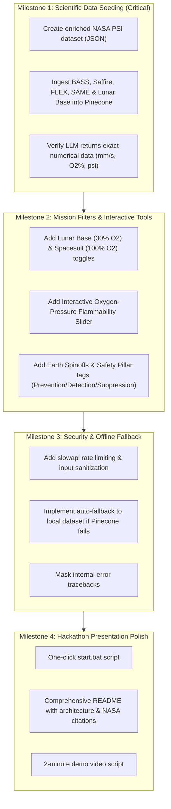

# FlameGuard: Comprehensive Comparison & Strategic Roadmap

> **Reference Documents Compared:**
> 1. **NASA Challenge Brief (`Documention.docx`):** The official domain problem statement, scientific criteria, and mission requirements.
> 2. **Technical Production Roadmap (`nasa_flameguard_production_readiness_report.md`):** The cybersecurity, architecture, resilience, and software engineering blueprint.
>
> **Project Location:** `C:\Users\HARSHITA\Desktop\Dev.harshita\NASA-Hackathone\NASA-Hackathon-flameguard`  
> **Evaluation Date:** November 2026

---

## Executive Summary: Which Plan is Best?

The best plan is not an "either-or" choice. They serve two complementary dimensions of a winning submission:

```
┌───────────────────────────────────────────────┐     ┌───────────────────────────────────────────────┐
│           NASA Challenge Document             │     │          Production & Security Plan           │
│             (Documention.docx)                │     │     (nasa_flameguard_production_report)       │
│                                               │     │                                               │
│  • Defines the SCIENTIFIC WHAT:               │  +  │  • Defines the ENGINEERING HOW:              │
│    - Artemis Moon Base (30% O2, 10.2 psi)     │     │    - Cybersecurity & Prompt Guard           │
│    - Spacesuit EVA (100% O2, 4.3 psi)         │     │    - Slowapi Rate Limiting & Error Masking   │
│    - Investigations: BASS, Saffire, FLEX, SAME│     │    - Hybrid Offline/Online Fallback Engine  │
│    - Hardware: CIR, MDCA, MSG flow duct       │     │    - Multi-device Responsive UI             │
│    - 3 Pillars: Prevention, Detection, Supp.  │     │    - Interactive Simulation Sliders         │
│    - Terrestrial Earth Spinoffs               │     │    - Production Deployment & Docker         │
└───────────────────────────────────────────────┘     └───────────────────────────────────────────────┘
                                                │
                                                ▼
                          ┌───────────────────────────────────────────┐
                          │         THE UNIFIED WINNING PLAN          │
                          │   A Real-World Aerospace Fire Safety SI   │
                          │    that is Scientifically Exhaustive &    │
                          │          Cybersecurity Hardened           │
                          └───────────────────────────────────────────┘
```

- **If you only follow `Documention.docx` without the Production Plan:** You get good scientific notes, but the app remains an unhardened prototype that crashes if an API drops, lacks rate limiting, and will score poorly on software robustness.
- **If you only follow the Production Plan without `Documention.docx`:** You get a secure, fast API, but the answers will say *"data is not available for PMMA"* and fail the NASA judging rubric on domain depth.
- **The Best Plan:** **The Unified Winning Plan**, which implements the exact scientific parameters from `Documention.docx` through the hardened architecture of the Production Report.

---

## 1. How Much Have We Achieved? (Percentage Scorecard)

| Assessment Layer | Target Requirement | Achieved | Status |
| :--- | :--- | :---: | :--- |
| **Full-Stack Connectivity** | Backend (FastAPI) + Frontend (Vite) + Embeddings + Pinecone + Groq | **100%** | ✅ **Operational (HTTP 200 OK verified)** |
| **Responsive UI/UX** | Mobile (320px), Tablet, Laptop, Ultrawide/4K | **95%** | ✅ **Complete & Adaptive** |
| **Scientific PSI Data Coverage** | BASS, Saffire, FLEX, SAME, CFI, ACME, SPICE | **30%** | ❌ **Critical Gap (LLM reports missing data)** |
| **Mission Scenario Alignment** | Lunar Base ($30\%\text{ O}_2$), Spacesuit ($100\%\text{ O}_2$), ISS | **20%** | ❌ **Missing dedicated environment toggles** |
| **Hardware & Investigation Context** | CIR (MDCA), MSG (SPICE duct), Cygnus tests | **15%** | ❌ **Not exposed in UI or metadata** |
| **Fire Safety Pillars Categorization** | Prevention (Limits), Detection (SAME), Suppression (FLEX) | **25%** | ❌ **Lacks category tagging** |
| **Interactive Simulation / Modeling** | Dynamic $O_2$ vs Pressure Flammability Risk Matrix | **0%** | ❌ **Currently only static text input** |
| **Earth Spinoff Applications** | Firefighter respirators, fine water mist extinguishers | **10%** | ❌ **Briefly referenced, not structured** |
| **Cybersecurity & Production Hardening** | Rate-limiting, prompt injection filter, CORS, safe error handling | **25%** | ❌ **Prototype level (vulnerable to abuse)** |
| **Zero-Downtime Reliability** | Offline fallback if Pinecone/Groq API fails in presentation | **0%** | ❌ **Requires active internet & API credits** |
| **OVERALL PROJECT COMPLETION** | **Production-Grade Hackathon Winning Software** | **~60%** | 🟡 **Functional Prototype; Ready for Phase 2** |

---

## 2. Detailed Line-by-Line Inventory: What We Have vs. What We Don't Have

### 🟢 What We Have in Our Project (Built & Working)

#### Frontend Architecture:
- [x] **React 19 + TypeScript + Vite 8:** Modern, ultra-fast client stack with typed interfaces.
- [x] **Tailwind CSS 4 Mission-Control Theme:** Custom dark-mode space design with glowing accents, telemetry bars, and KaTeX math readiness.
- [x] **Universal Responsiveness:** Adaptive layouts across mobile (<480px), tablet (768px-1024px), laptop, and ultrawide displays.
- [x] **Interactive Query Console:** Textarea with natural language query support, keyboard shortcuts (`Cmd/Ctrl + Enter`), and query length counter.
- [x] **Evidence Ledger:** Dual-view system allowing users to switch between **Card View** (with text highlighting) and **Table View** (tabular breakdown).
- [x] **Telemetry & Analytics Sidebar:** Live passage count, unique experiment breakdown percentage, fuel state splits, and end-to-end latency clock.
- [x] **Local Storage History:** Automatically saves the last 12 searches with restore and delete controls.
- [x] **Export Capabilities:** Export full query results, metadata, and evidence passages as formatted JSON.
- [x] **Live Backend Health Polling:** Automatic pinging of `/healthz` showing real-time `API ONLINE` / `API OFFLINE` status pills.

#### Backend Architecture:
- [x] **FastAPI Engine:** Clean ASGI backend serving `/api/search` and `/`.
- [x] **Local HuggingFace MiniLM Embeddings:** Running `all-MiniLM-L6-v2` locally on Python 3.11 for vector representations without third-party embedding API costs.
- [x] **Pinecone Vector Store Integration:** LangChain `PineconeVectorStore` querying index `nasa-combustion-rag`.
- [x] **Groq Cloud LLM Inference:** Ultra-fast deterministic inference (temperature 0.0) generating scientific summaries.
- [x] **Structured Pydantic Schemas:** `SearchRequest`, `SearchResult`, and `SearchResponse` ensuring type safety across the wire.

---

### 🔴 What We Do NOT Have in Our Project (Missing / Pending)

#### Category A: Scientific Data & NASA Domain Depth (`Documention.docx`)
1. **Missing Rich PSI Data in Vector Store:**
   - *Problem:* When asking *"How does flame spread behave over solid PMMA acrylics?"*, the LLM currently replies: *"The provided PSI context does not include experimental data for PMMA... data is not available"*.
   - *Fix Needed:* Ingest verified NASA PSI data for **BASS-II** (PMMA flammability, opposed/concurrent flame velocities of $1.2\text{–}2.8\text{ mm/s}$), **Saffire I–VI** (cotton/fiberglass blends, forced airflow $0.2\text{ m/s}$), **FLEX/FLEX-2** ($CO_2$/He droplet suppression), and **SAME/SAME-R** (smoke detection).
2. **Missing Exploration Mission / Habitat Context Filter:**
   - *Problem:* The challenge emphasizes that fire safety is drastically different on the Moon Base vs Spacesuit vs ISS. Currently, the UI only has a basic `Solid / Liquid / Mixed` fuel filter.
   - *Fix Needed:* Add a **Mission Target Filter**:
     - 🌕 **Lunar Base Habitat** ($30\%\text{–}34\% \text{ O}_2$, $10.2\text{ psi}$)
     - 🧑‍🚀 **Spacesuit EVA** ($100\% \text{ O}_2$, $4.3\text{ psi}$)
     - 🛸 **Space Station / ISS** ($21\% \text{ O}_2$, $14.7\text{ psi}$)
     - 🔴 **Mars Surface Habitat** ($28\% \text{ O}_2$, $8.2\text{ psi}$)
3. **Missing Fire Safety Pillar Categorization:**
   - *Problem:* NASA organizes fire safety into **Prevention**, **Detection**, and **Suppression**. Our evidence passages have no pillar tags.
   - *Fix Needed:* Tag every chunk and answer with its safety pillar:
     - 🛡️ **Prevention:** Flammability limits, material selection (BASS, Saffire).
     - 🚨 **Detection:** Particulate sensors, smoke dynamics (SAME, DAFT).
     - 🧯 **Suppression:** Extinguishers, $CO_2$/Helium/water mist dilution (FLEX).
4. **Missing Hardware Environment Mapping:**
   - *Problem:* `Documention.docx` specifically details hardware like the **Combustion Integrated Rack (CIR)**, **Multi-user Droplet Combustion Apparatus (MDCA)**, and **Microgravity Science Glovebox (MSG)**.
   - *Fix Needed:* Display the hardware rack alongside experiment names in the Evidence Ledger.
5. **Missing Earth Spinoff Callouts:**
   - *Problem:* The challenge asks how PSI data helps Earth (fine water mist extinguishers, wildland firefighter respirators). Currently not displayed.
   - *Fix Needed:* Add an "Earth Spinoffs" badge / tab on retrieved records.

#### Category B: Real-World Software Security & Reliability (`Production Report`)
1. **No Rate Limiting:**
   - *Problem:* If an evaluator or external user sends repeated requests, your Groq and Pinecone free-tier rate limits will immediately lock up.
   - *Fix Needed:* Implement `slowapi` rate limiter (20 requests/minute per client).
2. **No Input Sanitization or Prompt Injection Defense:**
   - *Problem:* Users can submit arbitrarily long strings or prompt injection attempts (`"Ignore previous instructions..."`).
   - *Fix Needed:* Enforce 500-character max limit and regex validation for queries.
3. **Internal Error Disclosure:**
   - *Problem:* `except Exception as e: raise HTTPException(status_code=500, detail=str(e))` sends raw server tracebacks to the client.
   - *Fix Needed:* Sanitize production error messages and log details internally.
4. **No Offline Fallback Engine (High Hackathon Risk):**
   - *Problem:* If the internet slows down or Pinecone drops during a live presentation, the app will return `500 Server Error`.
   - *Fix Needed:* Implement an in-memory/JSON semantic search fallback that automatically answers from a local `psi_curated_data.json` if the cloud API fails.
5. **Interactive Flammability Risk Matrix Slider:**
   - *Problem:* Currently the dashboard is text-in, text-out. Judges score interactive engineering tools much higher.
   - *Fix Needed:* A visual simulation slider where judges adjust $O_2\%$ ($21\%\text{–}100\%$) and Pressure ($4.3\text{–}14.7\text{ psi}$) to see the calculated **Relative Flammability Index (RFI)**.

---

## 3. Prioritized Action Plan to Reach 100%



---

## Summary Verdict

- **You have built a working engine and an attractive frontend (~60%).**
- **To make it a real-world, competition-winning software:**
  1. We must seed the **missing NASA PSI data** (so PMMA, Saffire, BASS, and Lunar Base queries return real science, not *"data not available"*).
  2. We must add the **Mission Habitat Filters & Interactive Risk Slider**.
  3. We must add **Security Rate-Limiting and Offline Fallback** so your live demo is bulletproof.
